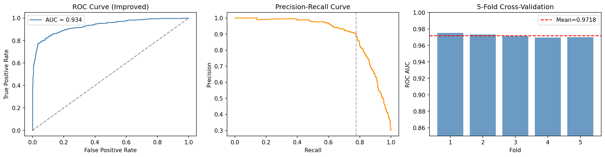
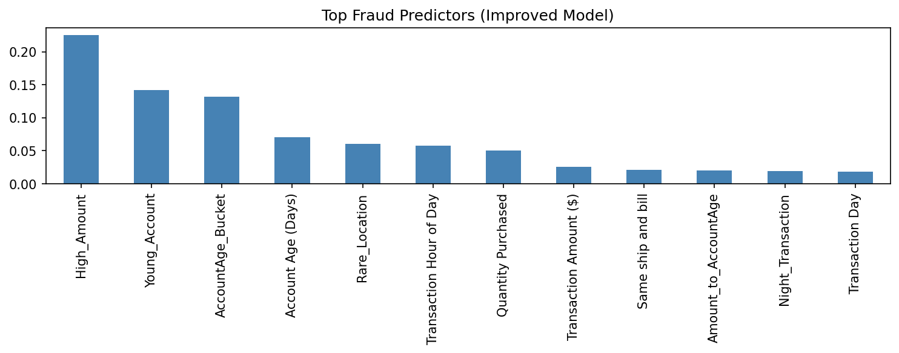
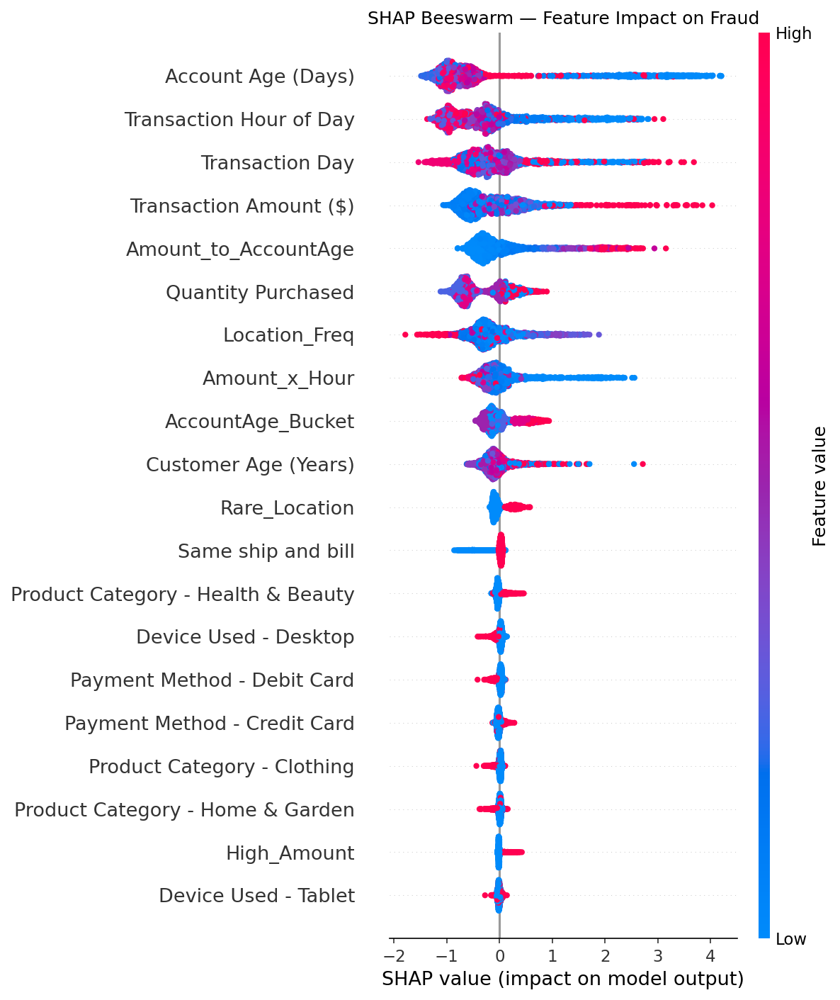
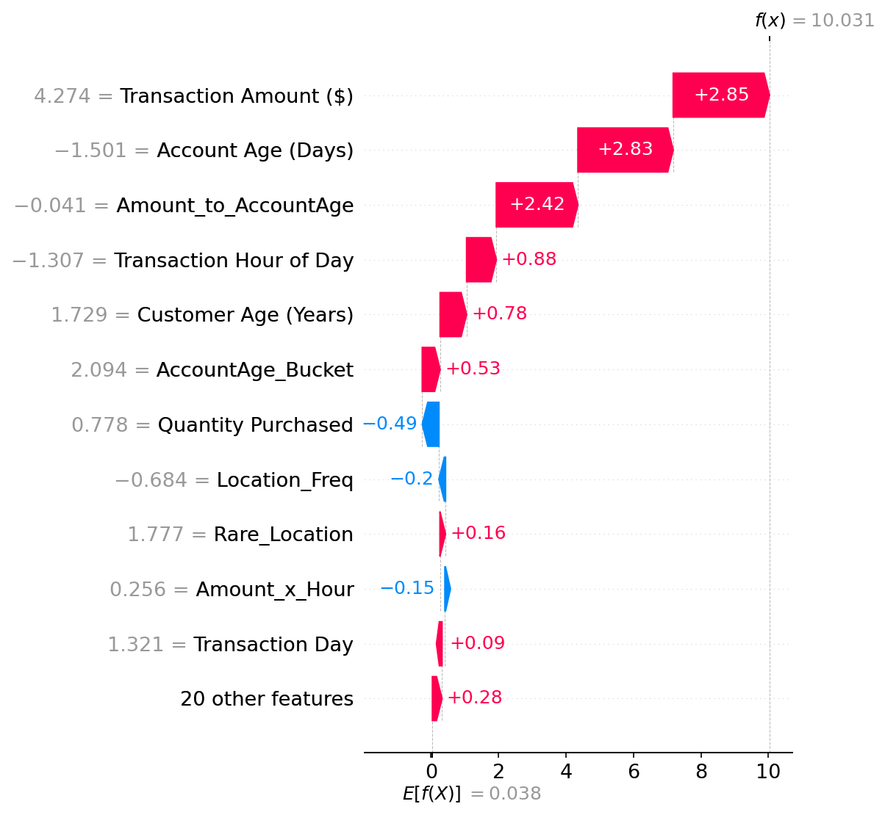

# Behavior-Based Financial Fraud Detection

Detecting fraudulent e-commerce transactions from **behavioral signals** — how much is spent, when, from which device, on how old an account, and from how familiar a location — instead of relying on raw transaction amount alone.

The pipeline builds a representative 10K-row dataset from ~1.5M transactions, engineers behavior-based risk features, handles class imbalance with SMOTE, and trains a **stacking ensemble (Random Forest + XGBoost + LightGBM → Logistic Regression)** with F1-optimized thresholding and **SHAP** explainability.

## Results

| Metric | Value |
|---|---|
| Test ROC-AUC (stacking ensemble) | **0.934** |
| Operating point (F1-optimal threshold) | ~0.90 precision at ~0.78 recall |



**Top fraud predictors:** high transaction amount, young accounts, account-age bucket, rare locations and transaction hour.



### Explainability (SHAP)

| Global impact | Single high-risk transaction |
|---|---|
|  |  |

## Approach

1. **Representative sampling** — fraud transactions randomly sampled (3,000 rows); non-fraud reduced to 7,000 rows using MiniBatch K-Means, keeping the real transaction closest to each cluster centre so the sample preserves the original distribution.
2. **Sample validation** — compares feature means and categorical distributions between the full dataset and the sample.
3. **Behavioral feature engineering**
   - `Amount_to_AccountAge`, `High_Amount`, `Young_Account`, `YoungAccount_HighAmount`
   - `Night_Transaction`, `Amount_x_Hour`
   - `Rare_Location` (low location frequency), `Mismatch_YoungAccount` (shipping ≠ billing on a new account)
   - `Device_Risk`, `Payment_Risk`, `AccountAge_Bucket`
   - log-transform of skewed features (transaction amount, location frequency)
4. **Imbalance handling** — standard scaling + SMOTE on the training split only.
5. **Modelling** — XGBoost baseline → feature-engineered XGBoost → stacking ensemble with 5-fold cross-validation.
6. **Threshold tuning** — picks the threshold that maximizes F1 on the precision–recall curve.
7. **Explainability** — SHAP beeswarm, bar and waterfall plots.

## Repository structure

| File | Purpose |
|---|---|
| `dataset_analysis_and_sampling.py` | Data quality checks, imbalance analysis, stratified 10K sample |
| `build_optimal_10k_dataset.py` | Cluster-based representative 10K dataset |
| `evaluate_optimal_dataset.py` | Validates the sample against the full dataset |
| `fraud_eda_analysis.py` | Exploratory data analysis |
| `fraud_model_xgboost.py` | Baseline XGBoost model |
| `fraud_model_feature_engineered.py` | XGBoost with engineered features + SMOTE |
| `fraud_detection_full_pipeline.py` | Stacking ensemble pipeline |
| `fraud_detection_improved.py` | **Final model** — improved features, CV, stacking, threshold tuning, SHAP |
| `results/` | Generated plots |
| `data/` | Place datasets here (not included) |

## Getting started

```bash
git clone https://github.com/<your-username>/Behavior-Based-Financial-Fraud-Detection.git
cd Behavior-Based-Financial-Fraud-Detection
python -m venv venv && source venv/bin/activate
pip install -r requirements.txt
```

Put the datasets in `data/` (see [data/README.md](data/README.md)), then run:

```bash
python build_optimal_10k_dataset.py   # needs data/Processed_data_FD.csv
python fraud_detection_improved.py    # needs data/optimal_10k_dataset.csv
```

## Tech stack

Python 3.13 · pandas · NumPy · scikit-learn · XGBoost · LightGBM · imbalanced-learn · SHAP · Matplotlib · Seaborn
